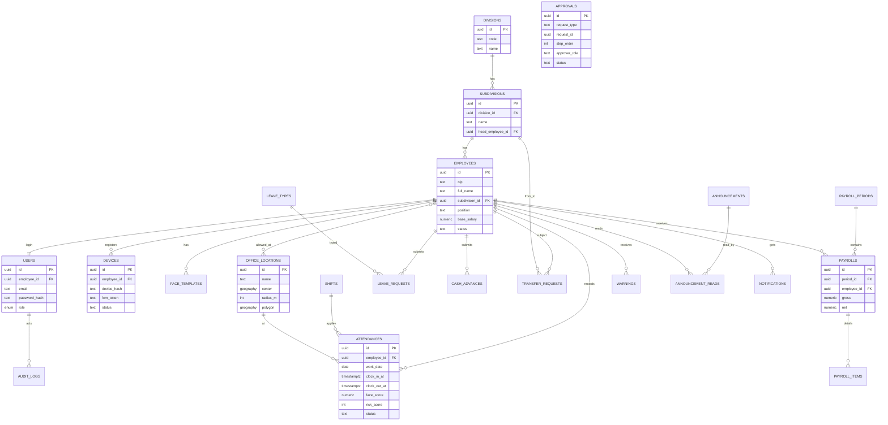

# ERD: HRIS Pejuang

Database: PostgreSQL + PostGIS + pgvector. DDL lengkap ada di `QUERY.sql`.

## Diagram

`APPROVALS` bersifat polimorfik (`request_type` + `request_id`) sehingga tidak digambar dengan garis relasi. Dipakai oleh `leave_requests`, `cash_advances`, `transfer_requests`.

## Daftar Tabel

| Tabel | Fungsi |
|---|---|
| divisions, subdivisions | Struktur organisasi |
| employees | Data Pejuang |
| users | Akun login + role |
| devices | Device binding, token FCM |
| face_templates | Embedding wajah (pgvector) |
| office_locations, employee_locations | Geofence, lokasi yang diizinkan per Pejuang |
| shifts | Jam kerja & toleransi telat |
| attendances | Presensi harian, skor risiko |
| leave_types, leave_requests | Cuti & izin |
| cash_advances | Kasbon |
| transfer_requests | Mutasi |
| approvals | Mesin approval generik |
| payroll_periods, payrolls, payroll_items | Upah & komponen |
| warnings | Surat Peringatan |
| announcements, announcement_reads | Pengumuman |
| notifications | Riwayat notifikasi |
| audit_logs | Jejak aksi |

## Aturan Data
- `attendances`: unik `(employee_id, work_date)`.
- `payrolls`: unik `(period_id, employee_id)`; periode `final` tidak boleh diubah.
- Ganti perangkat: `devices.status` = `pending` sampai disetujui SDM.
- Semua tabel utama punya `created_at`, `updated_at`; hapus data memakai soft delete (`deleted_at`) untuk employees.
- Mutasi disetujui penuh → job memperbarui `employees.subdivision_id` pada `effective_date`.
