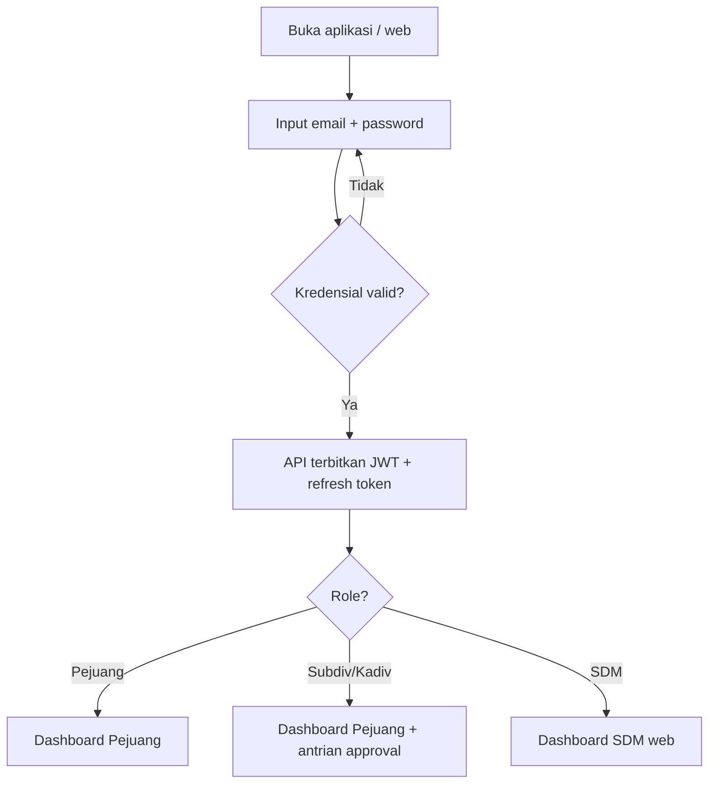
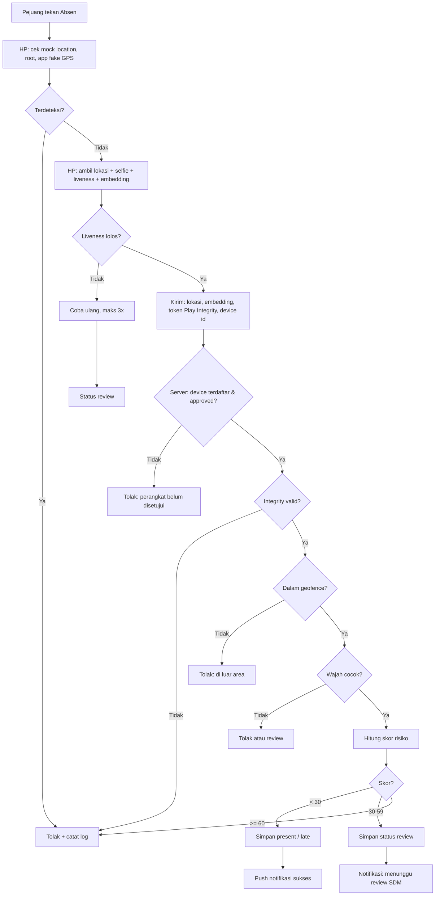
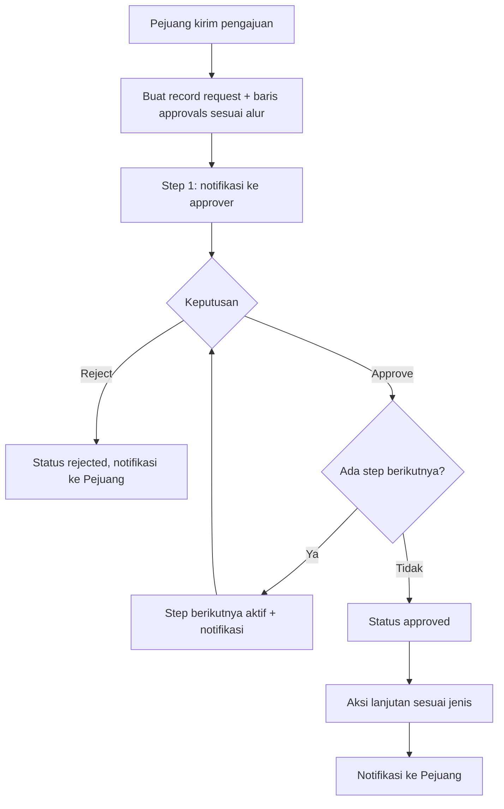
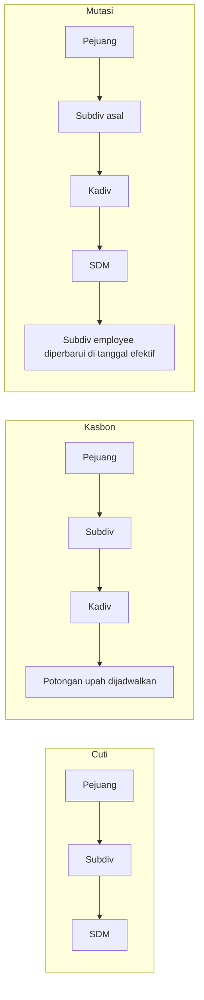
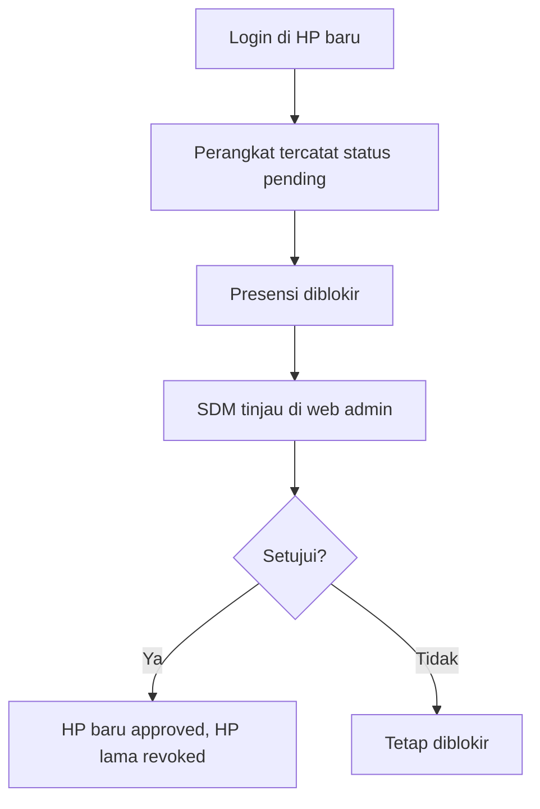
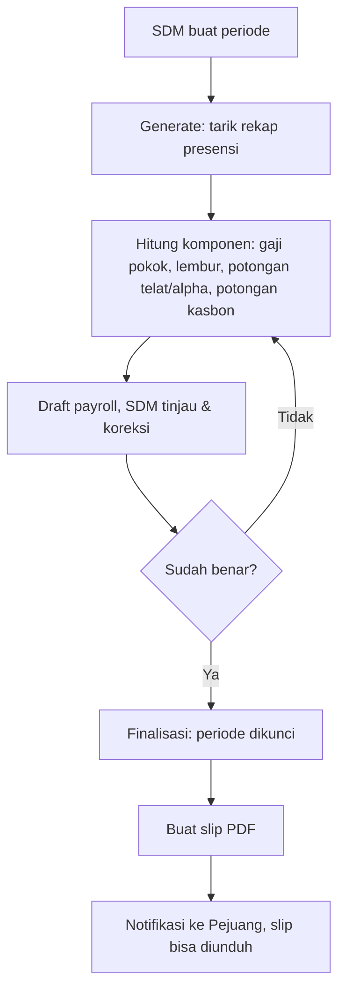
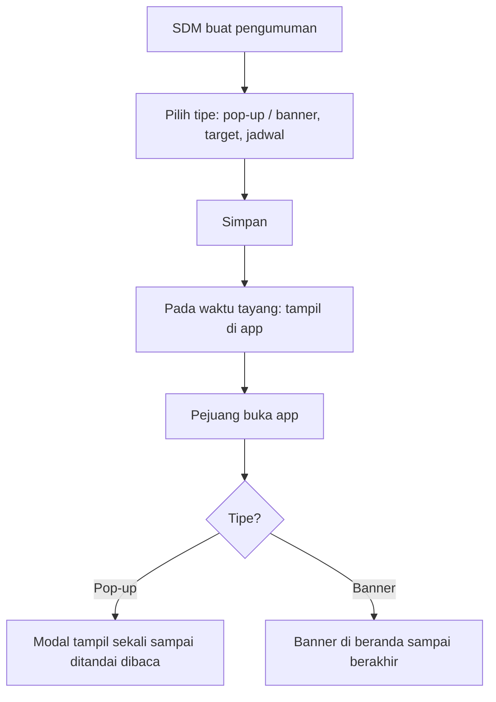
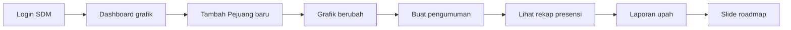

# FLOWCHART: HRIS Pejuang

Semua diagram memakai Mermaid (tampil otomatis di GitHub, VS Code, Notion).

## 1. Login & Role

## 2. Presensi (Clock In)

## 3. Mesin Approval Generik

## 4. Alur per Jenis Pengajuan

Alur di atas adalah asumsi awal; konfirmasi di PRD bagian 12.

## 5. Ganti Perangkat

## 6. Payroll Bulanan

## 7. Pengumuman

## 8. Alur Demo Jumat

