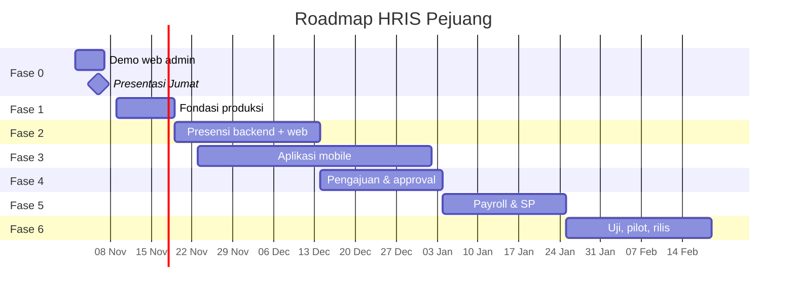

# ROADMAP: HRIS Pejuang

Estimasi untuk tim kecil (1-2 backend, 1 web, 1 mobile). Sesuaikan setelah kapasitas tim jelas. Tanggal dimulai dari Senin, 2 Nov 2026.

| Fase | Fokus | Estimasi | Target |
|---|---|---|---|
| 0 | Demo web admin (prototype) | 5 hari | **Jumat 6 Nov 2026** |
| 1 | Fondasi produksi | 1-2 minggu | pertengahan Nov |
| 2 | Presensi (backend + web) | 3-4 minggu | Des 2026 |
| 3 | Aplikasi mobile | 4-6 minggu (paralel dengan fase 2) | Des 2026 - Jan 2027 |
| 4 | Pengajuan & approval | 3 minggu | Jan 2027 |
| 5 | Payroll & SP | 3 minggu | Feb 2027 |
| 6 | Uji, pilot, rilis | 3-4 minggu | Mar 2027 |

## Visual

## Isi Tiap Fase

### Fase 0: Demo Web (minggu ini)
Login, master data, dashboard grafik, pengumuman, laporan presensi/upah (data dummy). Presentasikan sebagai prototype tahap 1.
**Selesai jika:** alur demo berjalan 2x berturut-turut tanpa error.

### Fase 1: Fondasi Produksi
Refresh token, audit log, OpenAPI, CI, staging, backup, hak akses per baris.
**Selesai jika:** staging berjalan di HTTPS, backup teruji.

### Fase 2: Presensi
Geofence, shift, device binding, enroll & cocok wajah, Play Integrity, skor risiko, review SDM.
**Selesai jika:** lolos uji serangan (fake GPS, foto, emulator, root) di 3 HP Android 10.

### Fase 3: Aplikasi Mobile
Login, profile, presensi (kamera, liveness, modul native), rekap, FCM, pengumuman.
**Selesai jika:** presensi end-to-end berjalan di HP kelas bawah.
Mulai paralel dengan Fase 2 begitu kontrak API presensi di OpenAPI disepakati.

### Fase 4: Pengajuan & Approval
Mesin approval, cuti/izin, kasbon, mutasi.
**Selesai jika:** satu pengajuan tiap jenis melewati seluruh rantai approval di web dan mobile.

### Fase 5: Payroll & SP
Aturan upah final, generate, finalisasi, slip PDF, SP.
**Selesai jika:** hasil hitung cocok dengan hitungan manual SDM pada 1 periode uji.
**Prasyarat:** aturan upah tertulis dan disetujui sebelum fase dimulai.

### Fase 6: Uji, Pilot, Rilis
Uji beban jam masuk, audit keamanan, persetujuan privasi, pelatihan, pilot 1 divisi, rilis bertahap.
**Selesai jika:** pilot 2 minggu tanpa insiden kritis.

## Dependensi Kritis
1. Aturan upah dan kasbon → blokir Fase 5.
2. Kontrak API presensi → blokir Fase 3.
3. Kebijakan HP tanpa Google Play Services → memengaruhi desain Fase 2-3.
4. Persetujuan privasi data wajah → wajib sebelum pilot.

## Risiko Jadwal
| Risiko | Dampak | Mitigasi |
|---|---|---|
| Liveness & wajah di HP lama bermasalah | Fase 3 mundur | Uji prototype kamera di minggu pertama Fase 3 |
| Aturan upah berubah-ubah | Fase 5 mundur | Kunci aturan tertulis, versi per periode |
| Tim mobile kurang | Fase 3 mundur | Fokus Android dulu, tunda iOS |
| Permintaan fitur baru saat demo | Scope melebar | Catat di backlog, jangan masuk Fase 0 |

## Setelah Rilis (Backlog)
iOS, BPJS/PPh21 otomatis, integrasi transfer bank, lembur dengan approval, shift rotasi, laporan analitik lanjutan, MCP/asisten data SDM.
